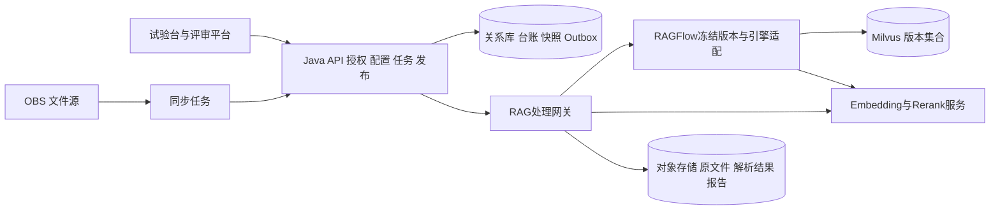

# RAG试验台复杂度与代码实现方案

编制日期：2026-10-22。依据：项目根目录《知识库技术方案（基于RAGFlow+Milvus）.docx》，重点对应第3.5、3.6、3.9节。当前目录仅有需求文档，没有现成应用代码、客户原型、接口或部署清单。本文件是可评审的实现设计，接口和路径为拟建契约，不代表已经完成开发或验证。

## 1 结论与范围

建议采用“Java业务控制层 + 自建试验台前端 + RAG处理网关 + RAGFlow定版适配 + Milvus”的模块化架构。先验证RAGFlow与Milvus的完整读写链路，再实现文件试验、黄金集评测、版本发布三个核心闭环，最后接入OBS同步和智能评审平台。整体复杂度中高；如果全部要求一次上线，属于高复杂度项目。

成功标准是同一份文档在不同解析、切分、检索配置下可重复试验，能用固定黄金集比较效果，并将通过验证的完整索引版本安全发布到指定专业室。不能仅以页面可点击、上传成功或返回相似文本作为验收。

### 1.1 分期

| 阶段 | 交付范围 | 明确边界 |
| --- | --- | --- |
| P0 技术验证 | 定版清单、适配能力矩阵、真实文档解析、向量写查删、过滤、更新恢复 | 不承诺生产容量，不以模拟检索替代适配验收 |
| P1 试验台MVP | 手动上传PDF/DOCX/TXT、文本修订、滑动窗口/递归字符/标题切分、参数扫描、向量检索、黄金集、历史、完整版本发布回滚 | 不包含OBS；不宣称完成全文档范围 |
| P2 完整功能 | XLSX与扫描件、父子/语义切分、BM25/RRF/重排对照、OBS/ZIP/续跑、模型与存储管理、专业室权限 | Python自定义解析采用部署的插件，HTTP解析采用管理端登记端点 |
| P3 业务上线 | 评审接口、适用版本规则、备份恢复、容量压测、生产监控 | 流程图复杂语义需样本验证及人工确认；工艺级知识库为后续扩展 |

以上是建议交付顺序，P1不是对原需求的完整验收。

## 2 原方案需要统一的决策

| 原文位置与问题 | 实现决策 |
| --- | --- |
| 3.1.3无需修改源码，与3.2.3/4.2需要Milvus适配冲突 | 预算中显式包含适配开发；只有定版POC通过后才能承诺集成完成 |
| 主要描述Python，但又涉及Go文档引擎 | 上游适配语言由冻结提交实际接口决定；Python处理网关不等于上游引擎也是Python；不提前写死Go SDK补丁号 |
| 3.5.2所有参数查询时覆盖 | 解析、切分、Embedding属于构建配置，必须生成新索引；TopK、融合、Rerank属于检索配置 |
| 3.5.4按文件名删旧，与后文业务键映射矛盾 | 按业务文件ID和保存的RAGFlow文档ID操作；禁止文件名作为唯一删除条件 |
| 先删后增，与3.6.1验证后切换冲突 | 推荐完整候选版本验证后发布；不默认接受旧数据先删除导致的空窗 |
| 别名切换被描述为灰度 | 单个别名只代表当前集合；灰度由Java按用户/请求固定分流到两个明确版本，单纯改别名只是全量切换 |
| 最新文件与适用版本混用 | 入库日期不等于法规/工艺生效日期；另存effective_from/effective_to与版本状态，规则缺失时返回需人工复核 |
| 五种切分都假定开箱即用 | 建立能力矩阵，原生支持则映射，不支持则网关实现；禁止用同一种算法伪装多个选项 |
| 同日重复幂等但文件内容可能变化 | 同路径同日内容变化标记SOURCE_CHANGED冲突，保留成功快照，人工显式创建修订；不静默覆盖 |
| 失败只靠failed，却允许pending和processing | pending可续跑；过期processing先对账，再转failed；abandoned计入未完成统计 |
| 只对变更片段重新向量化 | 首期以整份变化文档重算；内容缓存可复用未变化片段，但不得承诺已实现语义级差量 |

“解析效果优于Dify”“Milvus满足本项目效果”等原文表述尚无本项目对照数据支撑，应作为待验证假设。

## 3 复杂度与工作量

评分为工程判断，1最低、5最高，不是实测评分。

| 模块 | 复杂度 | 主要原因 | 估算人日 |
| --- | --- | --- | --- |
| 定版与POC | 4 | 上游接口、格式能力及依赖冻结 | 8–12 |
| RAGFlow与Milvus适配 | 5 | 不仅向量搜索，还有查询、删除、过滤、分页及恢复语义 | 18–30 |
| Java控制层与授权 | 4 | 资源归属、任务、不可变配置、审计 | 12–18 |
| 文件解析与切分试验 | 4 | OCR、位置映射、五种算法与参数扫描 | 12–20 |
| 检索与黄金集评测 | 4 | 指标定义、跨切分标签、混合检索公平性 | 12–18 |
| 发布与回滚 | 5 | 跨数据库状态、完整快照、并发与失败补偿 | 10–16 |
| OBS与ZIP同步 | 4 | 分页、幂等、锁失效、断点恢复 | 10–16 |
| 前端管理与试验页面 | 3 | 多方案比较、异步任务和证据定位 | 15–22 |
| 集成验证与运维 | 4 | 真实样本、权限回归、容量与恢复演练 | 12–18 |
| 合计 | 中高至高 | 不含模型训练和既有平台重大改造 | 109–170 |

建议增加20%–30%不确定性储备，总投入约131–221人日。前提：复用现有登录权限、OBS、Nacos、XXL-JOB环境，具备Java/Python开发能力，业务方提供样本和黄金标签。4名有效投入人员并配备业务评审支持，建议预留9–14周；不能简单将人日除以人数作为工期。P1约45–70人日，包含POC及可用适配子集，不与总量重复相加。若需深度修改新版本上游、增加Go人员或补建基础设施，需在P0后重新估算。

关键路径：定版与适配 → 可追溯解析/索引 → 可比评测 → 发布一致性 → 生产验收。前端可以用契约Mock推进，但Mock不算全链路完成。

## 4 架构与技术选择

| 路线 | 优点 | 成本 | 建议 |
| --- | --- | --- | --- |
| A RAGFlow定制Milvus引擎 | 保持原文主架构，流程统一 | 上游耦合深、升级回归成本最高 | Milvus为硬约束时采用，先做POC |
| B RAGFlow原生支持引擎 | 最小化定制，较快形成试验闭环 | 改变原文存储选型 | 若适配预算不足，作为替代方案，须单独变更范围 |
| C RAGFlow解析导出加自建Milvus检索 | 检索和切分控制更直接 | 需验证解析导出接口，可能维护两套索引 | A受阻且B不允许时评估，不在本期同时开发 |

本计划以A为主，RAG网关隔离上游版本差异。Java沿用既有Spring体系；若新建项目，可选Java 21和兼容的Spring Boot版本。前端默认Vue 3 + TypeScript，若既有平台采用React则复用原栈。关系库优先复用既有数据库，本计划DDL按PostgreSQL语义设计。Python网关使用FastAPI，任务状态持久化到关系库，Redis仅用于锁与短期缓存，避免同时引入多套队列。上述为建议，不是已发现的项目依赖；补丁版本由P0锁定。



RAGFlow自带的数据库、缓存与对象存储依赖应依据实际部署清单一并纳入，不得认为增加Milvus就能删掉其他依赖。业务用户只能访问Java接口，网关和引擎属于内部服务。

## 5 代码目录与边界

以下全部为拟新增路径；上游适配文件路径在P0读取冻结提交后确定，禁止臆造上游函数签名。

```text
backend/
  pom.xml
  src/main/java/cn/raglab/
    auth/AccessScopeService.java
    knowledge/KnowledgeBaseService.java
    config/StrategyVersionService.java
    document/DocumentVersionService.java
    experiment/ExperimentService.java
    evaluation/EvaluationService.java
    release/ReleaseService.java
    sync/ObsSyncJob.java
    sync/SyncFileProcessor.java
    sync/SafeZipExtractor.java
    integration/RagGatewayClient.java
    job/JobWorker.java
    job/OutboxDispatcher.java
  src/main/resources/db/migration/
  src/test/java/cn/raglab/
rag-service/
  pyproject.toml
  app/contracts.py
  app/api.py
  app/parsers/registry.py
  app/chunkers/{window,recursive,heading,parent_child,semantic}.py
  app/retrieval/{pipeline,fusion}.py
  app/evaluation/{metrics,evidence}.py
  app/adapters/{ragflow_client,milvus_admin}.py
  tests/
frontend/
  package.json
  src/api/
  src/pages/{Workbench,GoldenDatasets,Evaluation,Experiments,KnowledgeBases,Releases,SyncJobs,Models,Storage}.vue
  src/components/{ChunkPreview,ParameterGrid,MetricComparison,JobProgress}.vue
contracts/{openapi.yaml,examples/}
deploy/{compose.yaml,versions.lock.yaml}
tests/{contract,integration,e2e,performance}/
docs/{capability-matrix.md,runbook.md}
```

网关统一实现Parser、Chunker和Retrieval接口；Milvus写入由定制引擎唯一负责，网关管理适配器仅执行受控的版本集合运维，避免双写竞争。前端只接受公开DTO，不暴露上游密钥或任意Collection名称。

## 6 数据模型

所有业务记录使用服务端生成ID、created_at、updated_at；专业室授权通过关联知识库检查，审计记录用户、操作、请求ID和版本。

| 表 | 主要字段与约束 |
| --- | --- |
| knowledge_base | id, room_id, process_code可空, name, active_release_id, row_version；首期room_id唯一 |
| strategy_version | id, kb_id, version, parser/chunker/embedding/retrieval_config JSON, config_hash, code_revision；唯一(kb_id,version)，创建后不可改 |
| document | id, kb_id, business_key, file_name；唯一(kb_id,business_key) |
| document_version | id, document_id, source_date, source_uri, sha256, source_revision, effective_from/to, status；原始对象不可变保存 |
| index_version | id, kb_id, strategy_id, dataset_id, collection_name, manifest_uri/hash, status；manifest记录完整文档版本清单 |
| chunk | id, index_version_id, document_version_id, parent_id, ordinal, text_uri, page, section_path, source_spans, content_hash |
| experiment | id, kb_id, source_manifest, config_snapshot, seed, job_id, result_uri, status |
| golden_dataset_version | id, kb_id, version, schema_version, data_uri, sha256, split |
| evaluation_run/item | run_id, query_id, golden_version_id, index_version_id, retrieval_snapshot, hits, metrics, latency_ms, error |
| release | id, kb_id, index_version_id, previous_release_id, status, expected_row_version, published_by, published_at |
| sync_batch | id, source_id, target_date, status, continue_count, counters, error_summary；唯一(source_id,target_date) |
| sync_file_detail | id, batch_id, obs_path, parent_zip_path, kind, sha256, status, retry_count, lease_until, ragflow_doc_id, error；唯一(batch_id,obs_path) |
| ingestion_mapping | document_version_id, index_version_id, dataset_id, ragflow_doc_id；唯一(document_version_id,index_version_id) |
| job/outbox | id, kind, payload_ref, dedup_key, status, lease_owner/until, attempt, error；dedup_key唯一 |
| model_endpoint | id, type, model_name, revision, endpoint, secret_ref, dimension, timeout_ms, concurrency |

业务文件键建议为project/process/room/相对文件路径（去掉日期段），ZIP子文件包括母包相对路径和内部路径；同名跨项目文件不同键。重命名默认视为新文件，文件编号归并必须显式配置，不能猜测。

Milvus实体至少包含chunk_id主键、kb_id、room_id、document_version_id、index_version_id、text、dense_vector、source定位字段。BGE-M3候选采用1024维FLOAT_VECTOR与COSINE；BM25阶段增加相应文本分析和稀疏字段，不把BGE稀疏向量自动称为BM25。中文分词与文件编号保留规则必须评测。HNSW参数通过压测选取，不当成固定生产结论。

## 7 核心契约

### 7.1 外部HTTP API

| 接口 | 输入与返回 | 关键约束 |
| --- | --- | --- |
| POST /api/v1/kbs | name, room_id → kb_id | 仅管理权限 |
| POST /api/v1/files | multipart文件 → document_version_id | 类型/大小校验，保存原文件哈希 |
| POST /api/v1/experiments | kb_id, document_version_ids, parser, chunker, parameter_sets → job_id | 参数组最多20组，新增实验不修改原版本 |
| GET /api/v1/experiments/{id}/chunks | cursor,limit → chunks,next_cursor | 先校验实验所属知识库 |
| POST /api/v1/golden-datasets | JSON/CSV → dataset_version_id,validation_errors | 无效行拒绝导入，返回行号 |
| POST /api/v1/evaluations | golden_version_id, index_version_ids, retrieval_configs → job_id | 固定全部配置快照 |
| POST /api/v1/search | kb_id, query, top_k, as_of可选 → hits,release_id,degraded | room_id由服务端确定 |
| POST /api/v1/releases | kb_id,experiment_id,version,expected_release_id → job_id | 202表示受理，不表示发布成功 |
| POST /api/v1/releases/{id}/rollback | expected_release_id → job_id | 校验旧集合仍完整可用 |
| POST /api/v1/sync-batches | source_id,manual_date,continue → batch_id | 日期采用Asia/Shanghai |
| GET /api/v1/jobs/{id} | → status,progress,error | 权限检查后查询，前端轮询 |
| POST /api/v1/model-endpoints/{id}/test | → reachable,latency_ms,error_code | 密钥不回显，禁止普通用户任意探测URL |
| GET /api/v1/kbs/{id}/storage | → collection/index/count/status | 只展示有权限的知识库 |

写接口使用Idempotency-Key；冲突返回409，参数错误422，未授权403，上游不可用503。错误体统一为code/message/trace_id/retryable。请求取消只取消当前任务，不删除已发布资源。

### 7.2 内部代码接口草案

```java
record AccessScope(String userId, Set<String> knowledgeBaseIds) {}
record SearchCommand(String kbId, String query, int topK, Instant asOf) {}
record Evidence(String chunkId, String documentVersionId, String text,
                Integer page, String sectionPath, double score) {}
record SearchResult(String releaseId, List<Evidence> hits, boolean degraded) {}

interface RagGatewayClient {
    String submitBuild(String indexVersionId, String manifestUri,
                       String configSnapshotUri, String idempotencyKey);
    JobView getJob(String jobId);
    SearchResult search(SearchCommand request, AccessScope scope,
                        String pinnedIndexVersionId);
}
record JobView(String id, String status, int completed, int total, String errorCode) {}
```

```python
from dataclasses import dataclass
from typing import Protocol

@dataclass(frozen=True)
class SourceSpan:
    block_id: str
    start: int
    end: int
    page: int | None

@dataclass(frozen=True)
class Chunk:
    id: str
    text: str
    spans: tuple[SourceSpan, ...]
    parent_id: str | None

class Chunker(Protocol):
    def split(self, blocks: list[dict], config: dict) -> list[Chunk]: ...

class Retriever(Protocol):
    async def search(self, query: str, index_version_id: str,
                     authorized_kb_ids: list[str], top_k: int,
                     retrieval_config: dict) -> list[dict]: ...
```

代码块用于固定边界，真正DTO在contracts/openapi.yaml中补齐字段验证并生成客户端。scope必须来自内部已认证Java调用，不能允许浏览器直接提交。

## 8 关键流程实现

### 8.1 文件与切分

原文件 → 解析块（文本、表格、页码、坐标）→ 保存解析快照 → 可选文本修订 → 参数矩阵 → Chunk与统计 → 实验记录。手动修改文本生成新revision，不覆盖原始解析；无法映射回原文的修改标记synthetic，不虚构原页码。

长度滑块100–1600按Unicode码点计数，前后端保持一致；另外校验模型token上限。重叠比例建议0–0.5且必须小于1。滑动窗口保证步长至少1；递归字符按段落、句子、字符依次退化；标题分段保留完整章节路径；父子策略检索子块、返回父块并保留命中子块定位；语义切分使用固定模型与阈值。空文本直接产生明确失败结果，不创建空索引。

分号输入先解析为有限的结构化parameter_sets，拒绝不合法值和超过20组的扫描。每个子实验独立状态，失败不取消已成功方案。自定义Python仅允许运维安装和审核的插件，不接收用户任意代码执行；HTTP端点必须登记并限制可达网络与响应大小。

### 8.2 检索与评测

查询 → 授权知识库 → 固定release/index/model版本 → 识别文件编号及适用版本 → 向量与可选BM25独立召回 → 按chunk_id去重并RRF融合 → 可选Rerank → 返回可追溯证据。候选数以20/50对照，最终TopK默认5；参数可实验调整。RRF采用sum(1/(60+rank))，名次从1开始，不将原始向量分数与BM25直接相加。

专业室过滤必须发生在向量和全文两路候选召回之前；缓存键包含授权范围和发布版本；最终输出再次核对归属。无证据返回空结果及原因，评审模块标记待复核，不能把空结果解释为合规。

黄金集JSON字段：query_id、query、category、relevant_document_version_ids、relevant_evidence_spans、reference_answer、relevance_grades。CSV中数组字段使用JSON字符串并正确转义。Chunk ID可存为某索引版本内标签，但跨切分比较采用原文block_id与字符区间；解析器不同导致无法对齐的样本单列，不伪造公平比较。

| 指标 | 计算口径 |
| --- | --- |
| 文档Recall@K | TopK去重文档中相关文档数 / 相关文档总数；固定使用TopK文档，不与TopK块混用 |
| Chunk Recall@K | 同一索引标签下TopK块中相关块数 / 相关块总数 |
| Hit@K | TopK至少命中一个相关目标则1，否则0，再对问题平均 |
| MRR@K | 首个相关目标排名倒数，未命中为0 |
| nDCG@K | gain=2^grade-1，discount=log2(rank+1)，除以理想排序DCG |
| 片段覆盖率 | 命中块覆盖的黄金证据区间并集长度 / 黄金区间并集长度 |
| P95 | 按完整查询耗时排序，nearest-rank取ceil(0.95*N)；失败单列错误率及耗时 |

相关标签为空的“无答案题”不进入Recall分母，单独统计拒答/无依据回答。超时查询在有标签检索指标中记0，不能从样本中删除以提高分数。文档级候选聚合采用最高块分数，稳定tie-break用document_version_id。

将调参集和最终验收集分开冻结；所有方案使用相同问题、语料快照、访问范围。记录预热、冷/热缓存、并发及重排开关。答案正确率和引用正确率依赖业务人工标注或经验证的评审流程，不能用检索Recall冒充。

### 8.3 发布一致性

状态：DRAFT → BUILDING → VALIDATING → READY → PUBLISHING → ACTIVE；失败进入FAILED，旧版本继续可用。

发布策略时基于目标知识库的完整文档manifest构建新Dataset/Collection，不允许把只含试验样本文档的集合替换整个知识库。同一策略下未变化文档可复用解析结果及Embedding缓存，但候选集合必须包含完整有效语料。新策略/模型变更需全量处理。构建期间新到文档进入下一版manifest，避免边构建边修改输入。

以关系库active_release_id为业务读路由唯一真源；发布事务使用expected_release_id和row_version执行CAS并写Outbox。每次查询读取并固定物理Collection和Dataset，整个请求不追随可变别名。Milvus别名作为兼容映射由Outbox异步对齐，不参与跨系统“原子事务”假设；对齐失败告警并重试，业务读仍使用固定物理集合。适配层必须支持显式索引版本查询，否则P0不通过，不能以别名切换掩盖模型/配置不一致。

灰度使用服务端分流表固定到两个完整release；回滚CAS切换旧release。清理仅删除超过保留期、无活跃发布/灰度/任务引用的集合及对应Dataset；POC建议至少保留最近2版且不少于7天，生产依存储和恢复目标确认。历史结果快照保留，若删除原始索引则必须标记“不能在线重放”。

### 8.4 OBS同步与恢复

1. 按Asia/Shanghai生成目标日期，默认昨天；唯一(source_id,target_date)批次。Redis锁使用同一source/date维度、随机owner token、续租及原子校验释放；数据库lease/fencing防止锁过期后旧执行者继续写。
2. 分页扫描固定四层前缀，日期段严格解析，错误路径写目录级错误。没有匹配目录且无扫描错误才是success/0文件。
3. continue=false且已存在批次则跳过；continue=true复用批次，合并原台账与重新扫描清单。原failed文件不因OBS缺失而消失，保留SOURCE_MISSING错误。
4. 以(batch_id,obs_path)幂等。成功记录不重传；同日指纹变化标冲突。跨日期同业务键采用source_date单调比较，历史补跑不能覆盖更新版本。
5. ZIP先校验魔数、规范化路径，拒绝绝对路径、盘符、UNC、越界..和符号链接。建议初始限制1000个子文件、单文件100MB、累计1GB、压缩比100倍、禁止嵌套ZIP；限制为可配置假设。流式解压限制实际写出字节。
6. 上传返回后保存RAGFlow文档ID，轮询解析及索引可查询状态；成功必须在完整文档版本进入有效发布后确认。中间job阶段单独记录，不能上传成功就记success。
7. 文件失败不即时重试，续跑最多3次额外尝试，仍失败转abandoned。超时不等于请求没成功，先查映射及任务状态再补发。崩溃遗留processing通过lease到期后对账回收。
8. ZIP父记录kind=archive，仅作汇总；文件计数只计子文档，避免重复统计。部分成功含失败/abandoned/扫描错误记partial_success，全失败记failed。
9. OBS删除不传播删除；遗漏日期不自动补扫；仅日志和运维平台查询，不额外建设邮件或即时通讯通知。

## 9 实施任务与验证

各任务按“先写断言测试并确认失败 → 实现最小闭环 → 运行测试确认通过 → 更新契约与文档”推进。以下命令为未来实现后的计划命令，当前未执行，也不代表测试通过。

| 任务 | 文件与输出接口 | 必须验证的断言 | 验证命令与通过条件 |
| --- | --- | --- | --- |
| T0 冻结与POC | deploy/versions.lock.yaml、docs/capability-matrix.md、tests/integration/test_engine_contract.py；形成Engine能力清单 | 写入后带room过滤查询只返回本室；按ID删除不误删同名；重启后可查；旧索引可恢复 | pytest tests/integration/test_engine_contract.py -v；全部真实服务测试通过 |
| T1 领域与权限 | backend/auth、knowledge、config、db/migration；authorize(user,kb)与不可变strategy | 未授权查实验/Chunk/下载均403；重复version冲突；空授权不发引擎请求 | mvn -f backend/pom.xml test；AuthScopeTest、StrategyVersionTest通过 |
| T2 文档与任务 | document、job、rag-service/app/contracts.py；submitBuild/getJob | 重复key只生成一个job；上传后崩溃可对账；密钥不出日志；空文档明确失败 | mvn -f backend/pom.xml -Dtest=JobRecoveryTest,DocumentVersionTest test |
| T3 解析切分 | parsers/registry.py、chunkers/*；Chunker.split | 中文字符与表情计数一致；窗口无死循环；标题/表格位置保留；编辑后synthetic不伪造页码；参数组21个拒绝 | pytest rag-service/tests/test_chunkers.py rag-service/tests/test_provenance.py -v |
| T4 检索 | retrieval/*、adapters/*、RagGatewayClient.java；Retriever.search | 两路授权过滤一致；RRF公式固定；重排超时返回degraded；旧模型查询不得打新集合；文件编号保留 | pytest rag-service/tests/test_retrieval.py -v，并运行引擎集成测试 |
| T5 黄金集 | evaluation/*、EvaluationService.java；evaluate(run)输出明细与汇总 | relevant={a,b}、hits=[a,c,b]时Recall@2=0.5、Hit@2=1、MRR=1；全无命中为0；空标签不除零；超时不剔除 | pytest rag-service/tests/test_metrics.py rag-service/tests/test_evidence.py -v |
| T6 发布 | ReleaseService、OutboxDispatcher、milvus_admin；publish(kb,index,expected)/rollback | 只含样本的manifest拒绝发布；两个并发发布仅一个成功；别名更新失败仍读确定版本；失败构建保留旧数据 | mvn -f backend/pom.xml -Dtest=ReleaseConsistencyTest test；真实故障注入通过 |
| T7 同步 | ObsSyncJob、SyncFileProcessor、SafeZipExtractor；run(source,date,continue) | 跨项目同名不互删；历史补跑不降级；成功不重传；源删除不删索引；ZIP越界拒绝；续跑不丢failed；锁失效旧worker拒写 | mvn -f backend/pom.xml -Dtest=ObsSyncJobTest,SafeZipExtractorTest test |
| T8 前端与管理 | frontend/src/pages与components、contracts/openapi.yaml | 上传→对比→黄金评测→发布→回滚可操作；失败可见；模型密钥遮蔽；无权限资源不能访问 | pnpm --dir frontend test；pnpm --dir frontend exec playwright test；浏览器验收主流程 |
| T9 上线与评审 | tests/performance、docs/runbook.md、评审接口适配 | 引用指向正确文件版本；无证据待复核；备份包含原文/关系库/向量/版本配置；恢复后权限与查询仍正确 | 运行固定负载与恢复脚本，形成容量报告和签署验收记录 |

任务依赖：T0 → T1/T2 → T3/T4 → T5 → T6；T7依赖T2/T6；T8随契约推进，最终联调在T6/T7后；T9最后执行。P1只包含对应任务的MVP子集，其他断言在P2/P3完成前不能标记全项目通过。

五类重点回归：跨专业室同名文件；上传成功但客户端超时；构建期间更新文档；解析修改导致黄金定位失效；发布完成但别名同步失败。分别由T1/T7、T2、T6、T3/T5、T6覆盖。

## 10 验收与容量

建议先准备至少50份代表文档、100个检索问题及专门的越权/无答案/版本冲突测试集。这是POC起点，不是统计显著性保证。复杂表格和扫描件需人工核对原文，不把格式支持等同于内容正确。

建议业务协商的起始目标：文档Recall@5≥0.90、条款Recall@3≥0.85、测试集越权返回0次、受控版本选择测试100%正确。它们是拟定验收门槛，不是原文已有承诺或当前系统效果。答案及引用指标由业务标注后单独定门槛。性能P95、并发、索引延迟必须绑定硬件、模型、语料规模和请求类型，P0压测后写入验收基线，不在缺少条件时承诺毫秒数。

仅密集向量原始空间约为Chunk数×1024×4字节：100万块约4.096GB（3.81GiB）；还需加文本、元数据、HNSW、索引缓存、备份和副本，版本并存至少额外一套数据。GPU显存与推理吞吐必须按模型部署方式测量，不能由向量维度推导。同步增量只对变化文档计算向量，完整候选集合复制仍有I/O成本，应纳入构建耗时。

生产部署建议在Linux容器环境验证；Windows工作站可用于前后端开发。没有RTO/RPO和QPS数据前，不指定生产节点规格。备份恢复须联合恢复业务发布指针、manifest、Dataset、Collection和模型配置，不能只恢复Milvus。

## 11 信息缺口与下一阶段交付

开工前补齐：既有Java/前端/数据库版本和认证接口；RAGFlow目标提交；OBS接入方式与凭据注入机制；真实样本及原型；专业室数量、文档量、日增量、并发与硬件；适用版本规则与点检项契约。缺口不妨碍评审本方案，但决定P0后的版本锁定、容量和最终排期。

下一阶段首先产出可运行的POC、冻结版本清单、真实适配能力矩阵及测试报告，再按任务实现试验台。不要从完整管理页面开始后才验证Milvus适配。

## 12 外部技术核对依据

截至编制日进行了公开资料核对，但未在本地安装运行这些组件。RAGFlow动态文档页面正文未能完整读取，不能据此确认某个冻结版本的全部API能力；原文指定的Milvus Server/Go SDK 2.6.24组合仍须实测，不视为已认证兼容。

- [RAGFlow官方仓库](https://github.com/infiniflow/ragflow)：当前公开目录包含Go模块和Python SDK，支持“按冻结提交选择适配语言”的判断，不能继续默认所有服务端适配都是Python。
- [BGE-M3模型卡](https://huggingface.co/BAAI/bge-m3)：1024维、8192 token上限；模型上限不等于建议分块大小。
- [Milvus过滤检索](https://milvus.io/docs/filtered-search.md)：支持检索表达式过滤，业务授权仍由Java负责。
- [Milvus RRF](https://milvus.io/docs/rrf-ranker.md)：基于排名融合，常用平滑参数60。
- [Milvus别名管理](https://milvus.io/docs/manage-aliases.md)：别名映射到单个集合，可重新指向；不提供业务数据库与模型配置的跨系统事务。

上述Milvus网页可能默认展示3.x文档，仅用于核对概念；本项目若固定2.6.x，必须在P0核验对应版本API及行为，不直接复制不同主版本示例。
