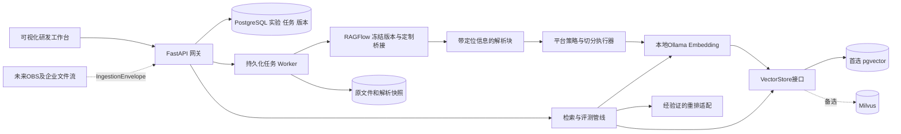

# RAG研发试验平台架构与代码实现方案

版本：v2，2026-10-22。依据：用户最新范围调整及原《知识库技术方案（基于RAGFlow+Milvus）》中试验、评测和发布需求。此版本替代v1，旧版仅供追溯。本文是实现计划，未标为“已验证”的功能均为待开发能力。

## 1 平台定位与范围

平台面向企业的数据处理研发人员，提供可视化文档处理策略配置、参数试验、召回效果比较及版本化发布。产品定位为RAGFlow和Dify在企业文件处理研发场景的增强平台：复用RAGFlow的文档处理能力，自建研发工作台，把企业文件流、处理策略、评测依据和可发布成果串起来。

首期架构为：自建前端 + Python RAG处理网关及Worker + RAGFlow冻结版本与定制适配 + 可替换检索存储 + 本地Ollama。优先验证现有PostgreSQL中的pgvector，不能满足时部署Milvus。Java业务层、企业SSO、点检项合规判断、Nacos、XXL-JOB均不进入首期实现。OBS和企业文件流仅预留接入契约与统一入库模型，不提前建设完整连接器。

“增强版本”体现为可追溯的处理试验、统一策略预设、可比较的评测和可靠发布；首期不同时Fork Dify或重建通用Agent编排、插件市场和聊天应用平台。Dify可作为后续检索API的消费者，不是本期运行依赖。

成功标准：用户从同一批源文件出发，选择预设或修改参数，比较多种切分和召回策略，在固定黄金集上确定优选方案，再把完整语料和配置作为不可变版本发布、验证和回滚。

## 2 本地核对结果

| 项目 | 本次观察 | 结论 |
| --- | --- | --- |
| Ollama | CLI版本0.35.1；OLLAMA_HOST=127.0.0.1:11436 | 使用实际配置，不能默认11434；本机11434未找到目标Embedding模型 |
| Embedding | qwen3-embedding:0.6b；对两条中文文本调用/api/embed成功，均返回1024维向量 | 可作为首期稠密向量基线；本次调用约5秒包含加载因素，不是性能基准 |
| Embedding标识 | ac6da0dfba84a81fdbfbaf330198c33cd77c4cdfc53e8bc50eb581914a15621d | 实验记录完整digest，禁止仅依赖可变模型标签 |
| Reranker | dengcao/Qwen3-Reranker-0.6B:F16及Q8_0已安装；Q8_0能力显示completion | 已安装不等于已有可靠的重排分数接口；独立验证后启用 |
| PostgreSQL容器 | graphrag-postgres-age，已停止；映射127.0.0.1:5432 | 当前未连接数据库，也未改动既有数据 |
| 数据库构建配置 | 基于apache/age:release_PG17_1.7.0，编译pgvector v0.8.6；初始化SQL包含age及vector扩展 | 有复用依据；仍需查询实际运行版本及目标数据库pg_extension |
| 代码 | 已拉取upstream/ragflow，调研SHA为e2401e54947db7eb5e542b6de26755d89886f783 | 源码未修改，尚未构建；调研提交不等于生产定版 |

数据库构建配置来自现有容器的Compose工作目录D:/公司文件/26年实施项目/GraphRAG/config/postgres-age。配置文件不能证明既有数据卷已经执行了新初始化脚本。启动后以SELECT version()、pg_extension和pg_available_extensions结果为准；不打印连接密码，不重建原卷。

Apache AGE负责图数据；pgvector负责向量相似性。首期不实施GraphRAG，AGE保持现状。新增独立rag_lab数据库及最小权限角色，避免在原GraphRAG业务表中混写；扩展需在新数据库单独启用，不能假定实例安装即各数据库可用。

## 3 架构和定制边界



网关接管原Java层中的平台内部任务、权限、配置、实验和发布职责，但不承载企业业务审批。部署初期API与Worker可共用代码包、独立进程；用PostgreSQL任务表和lease实现持久任务，不要求Redis、Celery或外部消息队列作为新增依赖。

RAGFlow定制采用“解析桥接优先、引擎替换后置”的推荐路线：冻结源码，检查能否稳定导出解析块、表格与位置；优先复用已有接口，缺少稳定接口时在独立定制分支增加内部桥接。平台切分、向量写入和检索由Worker及网关统一控制，VectorStore只有一个写入责任方。不能让RAGFlow自动再次切分已由平台切分的文本，也不能后台同时写两套平台索引。

这条路线调整了v1的“必须替换RAGFlow文档引擎”要求，目的是让本地pgvector可先验证，避免把全部研发界面与某个上游引擎绑定。RAGFlow原生引擎若仍是解析任务的运行依赖，应在部署清单明确保留；不得声称pgvector或Milvus自动替代了所有上游依赖。先量出真实资源成本，再决定是否提取独立解析Worker。

| 路线 | 取舍 | 决策 |
| --- | --- | --- |
| 解析桥接 + 自管切分/检索 | 可直接控制实验和存储，需维护解析块契约，可能仍保留原生引擎依赖 | 首选，P0必须验证定位完整性和依赖成本 |
| 定制RAGFlow文档引擎 | 复用上游完整检索流程，需实现更广的查询与生命周期语义 | 解析桥接不可行时评估；另估适配成本 |
| 只使用RAGFlow原生检索 | 接入较快，但不保证使用本地pgvector或Milvus | 仅作为基线对照，不暗中替代目标架构 |

## 4 RAGFlow获取和定版步骤

1. 从官方仓库拉取到upstream/ragflow，读取仓库AGENTS.md、许可证和部署说明。
2. 检查实际目录、语言、解析入口和SDK。禁止照搬“RAGFlow全部是Python”或未核实的Go引擎接口假设。
3. 对比稳定标签与当前分支，选取能完成桥接且依赖可部署的版本；主分支仅作调查，不自动视为生产基线。
4. 记录commit SHA、镜像digest、依赖锁文件、解析模型权重和定制补丁版本。创建定制分支，保持改动集中在桥接及必要适配目录。
5. 输出capability-matrix：每种格式的解析入口、是否OCR、表格结构、页码/坐标、错误行为、是否需要原生索引引擎及资源占用。
6. 在定制前后跑同一组契约测试；将解析后的标准块转换为平台ParsedDocument，而不是让前端依赖上游内部字段。

已核对当前提交的ParseResultProducer.ParseWithResult及internal/parser/parser/parse_result.go结构化结果契约，可作为解析桥接调查入口。上游定制遵循AGENTS.md使用Go，外部FastAPI网关独立部署。当前internal/engine未见专用pgvector/Milvus实现，Vastbase的PG兼容配置也不等于已验证普通PostgreSQL兼容。代码拉取用于调研，源码可读不代表已完成版本兼容验证。上游具体改动文件只有读取实际代码后才在POC任务中确定，不提前捏造路径。

## 5 pgvector优先与Milvus切换条件

先验证扩展和正确性，再判断性能，不因容器当前停止就宣布pgvector不行。

### 5.1 pgvector路径

- 在独立数据库使用vector(1024)，参数化SQL限定workspace_id、index_version_id，首轮以精确余弦搜索作为正确性基线。
- 同一索引版本固定Embedding digest、维度、归一化及查询前处理配置。更换模型必须新建索引版本，即使维度相同也不能混用向量空间。
- 在代表性数据上增加HNSW，对比精确检索的ANN Recall、过滤后结果数量及延迟。检查锁定pgvector版本的迭代扫描/过滤行为，避免过滤后不足K却误判召回质量。
- BM25通过独立LexicalRetriever提供。PostgreSQL全文ts_rank不等于BM25，不能在UI中冒充；MVP可按冻结索引构建中文分词的BM25快照，适用于本地样本，规模扩大后再替换实现。
- 原文、表格JSON及报告初期落本地内容寻址目录，路径经BlobStore封装，后续替换对象存储。

### 5.2 决策门槛

P0先投入最多3个工作日验证现有pgvector路径，完成：两组1024维中文向量写查删、空间隔离、版本隔离、批量幂等、进程重启后可查、精确与ANN对照。建议在1万/10万块两级数据上记录纯检索P95（排除模型加载）、错误率与资源占用；若本机无法承载第二级，明确记录而非编造结果。

拟定本地起始门槛：10万块、并发5时纯向量检索P95≤500ms，ANN相对精确检索Recall@10≥0.95；这是可调整的POC目标，尚未实测。应区分数据库瓶颈与Ollama/OCR瓶颈，后者不通过更换Milvus解决。

扩展无法在隔离数据库启用、索引过滤正确性无法满足、或合理调参后仍不满足已确认容量门槛时，部署Milvus备用profile并用相同数据和模型重测。迁移步骤为导出不可变manifest → 写入候选Milvus集合 → 对照评测 → 发布存储绑定；不在线双写，不覆盖旧索引。业务台账继续使用PostgreSQL。

## 6 本地模型验证

EmbeddingProvider对Ollama /api/embed封装batch_embed(texts, model_binding)，使用truncate=false；超长输入明确分段或拒绝，不能静默截断影响评测。统一查询指令前缀并版本化，文档和查询预处理遵循所选模型要求。记录digest、上下文配置、输入hash、输出维度、耗时、错误；首次加载与热运行分别计时。

本次两条中文输入均返回1024维，只证明Embedding基础调用成功。P0还需验证语义相关文本排序、批量顺序、超长输入、服务重启及容器到宿主网络。Docker内不得使用127.0.0.1指向宿主，需验证host.docker.internal:11436是否可达；若宿主Ollama仅监听回环，应选择宿主Worker或经过受控配置的网络连接。

Reranker的Q8_0/F16作为候选，不直接把生成yes/no当成有统计意义的相关性分数。先检查模型模板、推理运行时是否能获得要求的评分/logprob及批量映射；用有人工顺序的小样本确认单调性、稳定性和分数方向。通过后实现Reranker.rerank。若Ollama不能提供可靠接口，首期默认关闭重排，仍完成向量/BM25/RRF评测；需要时另部署专用重排服务。不得把这个失败归因于向量数据库。

目前模型列表没有确认通用问答模型。三个核心闭环不依赖生成模型，因此不额外下载大模型；问答演示、LLM评审与视觉理解列为后续可选能力。

## 7 三个核心闭环及页面

### 7.1 文件处理试验

上传PDF/DOCX/TXT/MD → 内容hash和原始快照 → 选择解析器及预设 → 预览解析文本、表格和来源 → 配置切分 → 单次或参数扫描 → Chunk对照 → 保存策略版本。

首批预设：通用文本递归切分、固定滑动窗口、制度规范标题层级、FAQ问答成对、表格按行组且保留表头。第二批：父子分段、语义分段、扫描PDF OCR、代码/Markdown结构化切分。每个预设公开算法、适用格式、长度单位、重叠及失败回退；未实现的策略禁用并标注，不能用同一算法替代。

建议初始字符窗口800、重叠100；可扫400/800/1200与重叠0/100，最多20组。字符按Unicode码点计数，另外检查token上限。表格跨块重复表头但不把重复表头算成额外证据。手工编辑生成derived revision，无法映射回原文的文字标记synthetic。

工作台采用步骤表单和左右预览：左侧文件与结构，右侧策略及参数，下方Chunk统计、长度分布、来源定位和差异对照。首期不开发任意代码执行或复杂DAG画布。

### 7.2 黄金集评测

CSV/JSON导入 → 校验问题与证据 → 冻结黄金集版本及语料快照 → 选择索引/检索方案 → 异步评测 → 总览及逐题失败分析 → 标记候选策略。

黄金标签包含query_id、query、相关文档版本、原文block/字符区间、相关性等级及可选参考答案。跨切分使用稳定原文证据，不直接比较不同索引的Chunk ID；跨解析器无法对齐的样本单独列出。划分调参集与验收集，禁止不断用验收集挑参数。

| 指标 | 固定口径 |
| --- | --- |
| 文档Recall@K | TopK去重文档中相关文档数/相关文档总数，块级另报 |
| Hit@K | 是否至少一个相关目标，再对问题平均 |
| MRR@K | 首个相关目标倒数排名，无命中为0 |
| nDCG@K | gain=2^grade-1，discount=log2(rank+1)，以理想DCG归一 |
| 证据覆盖率 | 命中块覆盖黄金区间的并集长度/黄金区间总并集长度 |
| P95与错误率 | nearest-rank分位数，报告总查询及分阶段耗时，超时单列 |

有标签的超时题效果计0，不从分母剔除；无答案题另算错误召回/拒答，不除零。向量、BM25、RRF都先限制workspace和索引版本；RRF默认sum(1/(60+rank))。结果包含原始候选、融合排名、重排分数（若启用）、来源和耗时，便于研发定位问题。

### 7.3 版本发布

候选策略 → 冻结目标知识库完整manifest → 构建新索引 → 数量/模型/权限/黄金集验证 → READY → CAS切换active_release_id → 验证查询 → 可回滚。

实验仅含样本时，发布动作创建完整语料构建任务，绝不能直接发布样本集合覆盖知识库。发布版本绑定parser/chunker/code/model digest、语料清单、黄金集版本及vector backend。查询开始时固定release及对应物理索引，整个请求不追随变化的全局默认模型。

pgvector以index_version_id隔离，PostgreSQL事务切换发布指针；Milvus使用不可变集合并由同一数据库指针路由，别名仅为可选兼容映射，不当作跨库事务。构建失败保留旧版；两个并发发布基于expected_release_id只能一个成功；回滚先验证旧数据存在。初期保留最近2版且至少7天，清理前检查活跃发布/实验/任务引用。

页面包括：文件试验台、策略库、黄金集、评测比较、实验历史、知识库与发布、模型和存储诊断。OBS及内部接入仅展示设计契约或禁用入口，不假装已可同步。

## 8 预留企业文件流

统一入口IngestionEnvelope：workspace_id、source_type、source_id、external_document_id、source_revision、file_name、mime_type、expected_sha256、metadata。内部document_id与外部业务键分离；唯一(source_id,external_document_id,source_revision)，重复相同hash返回原受理结果，不同hash返回409。

预留协议：POST /api/v1/ingestions接收multipart或application/octet-stream，元数据通过受限JSON part或约定头传递；服务端流式落盘并累计hash/字节，完成校验才提交任务，返回202及ingestion_id。GET /api/v1/ingestions/{id}轮询状态；后续回调需独立签名与重试契约。流式接收不等于边收边解析；中途断流清理临时文件，不提前创建成功版本。首期只完成契约和本地流式上传共用入口测试，不交付企业服务鉴权、回调或真实对接。

OBSConnector预留scan(cursor)->FileRef列表与open_stream(ref)；后续将对象路径/版本号转成同一Envelope，不新增第二套入库逻辑。删除事件默认不删除已发布证据；数据生命周期需显式策略。ZIP安全解包、OBS分页、按日期续跑及企业限流放后续连接器里程碑。

## 9 代码结构与接口

```text
upstream/ragflow/                  官方源码及独立定制分支
frontend/src/
  pages/Workbench.vue StrategyLibrary.vue GoldenDatasets.vue
  pages/EvaluationCompare.vue Experiments.vue Releases.vue Settings.vue
  components/ChunkPreview.vue ParameterGrid.vue EvidenceViewer.vue
rag-gateway/
  pyproject.toml
  app/api/{files,experiments,evaluations,releases,models,jobs}.py
  app/domain/{documents,strategies,indexes,ingestion}.py
  app/services/{experiment,evaluation,release}.py
  app/worker/{runner,leases}.py
  app/adapters/ragflow/{client,parsed_blocks}.py
  app/adapters/models/{ollama,reranker}.py
  app/adapters/vector/{base,pgvector,milvus}.py
  app/adapters/blob/{base,local}.py
  app/connectors/{base,obs_contract}.py
  app/chunkers/{registry,window,recursive,heading,faq,table,parent_child,semantic}.py
  app/retrieval/{pipeline,lexical,rrf}.py
  app/evaluation/{metrics,evidence_alignment}.py
  migrations/
  tests/{unit,contract,integration}/
contracts/{openapi.yaml,ingestion.schema.json,parsed-document.schema.json}
deploy/{versions.lock.yaml,compose.yaml,profiles/}
docs/{capability-matrix.md,local-validation.md,runbook.md}
```

前端建议Vue 3 + TypeScript；网关FastAPI + Pydantic + SQLAlchemy/Alembic。依赖补丁版本在环境验证时锁定。pgvector与Milvus共用VectorStore契约，但P0通过pgvector时只实现该后端；Milvus仅预留接口和部署计划，不为“可扩展”同时写两个未验证实现。

```python
class VectorStore(Protocol):
    async def create_index(self, binding: IndexBinding) -> None: ...
    async def upsert(self, binding: IndexBinding, rows: list[VectorRecord]) -> None: ...
    async def search(self, binding: IndexBinding, query_vector: list[float],
                     scope: AccessScope, top_k: int) -> list[SearchHit]: ...
    async def delete_document(self, binding: IndexBinding, document_version_id: str) -> None: ...
    async def inspect(self, binding: IndexBinding) -> IndexStatus: ...
```

类型定义：IndexBinding包含index_version_id、workspace_id、backend、物理表/集合、dimension、metric、model_digest；VectorRecord包含chunk_id、document_version_id、workspace_id、text、vector和source_spans；AccessScope来自服务端认证；SearchHit包含chunk_id、score、document_version_id和来源；IndexStatus包含ready、row_count、dimension和error。所有查询失败关闭，不接受前端任意SQL、集合名或过滤表达式。

数据库实体：workspace/member；knowledge_base(active_release_id,row_version)；document及不可变document_version；parse_snapshot；strategy_version(config_hash)；index_version(manifest_hash,backend,model_binding)；chunk及source_spans；experiment/experiment_variant；golden_dataset_version；evaluation_run/item；release；job(lease,attempt,dedup_key)；model_binding；ingestion_receipt。模型密钥只存secret_ref。pgvector行必须带workspace与index版本，原文件/解析结果用内容hash定位。

主要API：POST /files、/experiments、/golden-datasets、/evaluations、/releases；POST /releases/{id}/rollback；POST /search；GET /jobs/{id}、/experiments/{id}/chunks、/models、/storage/health。路径统一/api/v1前缀，异步返回202，冲突409，参数错误422，上游不可用503。基础工作区角色为管理员/研发/只读，本地开发凭据不等于企业SSO。

## 10 实施任务与验收

以下是未来实现任务，不是已通过的测试。本次完成范围是方案调整、环境轻量探测及RAGFlow源码拉取和入口核对。详见local-validation.md。

- [ ] T0 获取和锁定RAGFlow：读取上游说明，记录SHA，跑真实PDF/DOCX/TXT解析，完成ParsedDocument契约及依赖矩阵。验收：页码/段落真实可追溯，失败可诊断，不以Mock替代。
- [ ] T1 本地基础能力：在隔离数据库检查扩展，Ollama中文批量Embedding，验证VectorStore写查删/隔离/维度并完成pgvector决策。测试tests/integration/test_vector_contract.py，失败时再实施Milvus profile，同一测试须通过。
- [ ] T2 文件与Worker：实现流式上传、hash、不可变快照、持久任务和lease；测试断流不入库、重复key单任务、超时后对账、Worker崩溃恢复。文件为api/files.py、worker/*及tests/integration/test_job_recovery.py。
- [ ] T3 策略与工作台：实现首批五种预设、参数矩阵、Chunk对照和定位；测试Unicode计数、窗口进度、表头保留、20组上限、编辑来源标记。测试tests/unit/test_chunkers.py和test_provenance.py。
- [ ] T4 检索与评测：实现向量/BM25/RRF和黄金集导入，Reranker通过协议验证后可选启用。测试relevant={a,b},hits=[a,c,b]时Recall@2=0.5、Hit@2=1、MRR=1；无标签/超时/重复文档口径正确。测试test_metrics.py、test_retrieval.py、test_evidence_alignment.py。
- [ ] T5 发布回滚：实现完整manifest构建、验证门槛、CAS切换及清理；测试样本集合不能直接全量发布、并发仅一个成功、失败保留旧版、查询固定模型与索引。测试tests/integration/test_release_consistency.py。
- [ ] T6 文件流预留：固化IngestionEnvelope、上传和Connector接口，测试分块传输不整文件入内存、hash冲突409、重复请求复用结果；不执行OBS扫描和企业真实接入。测试tests/contract/test_ingestion_contract.py。
- [ ] T7 全流程与诊断：Playwright完成上传→预设→实验对比→黄金评测→发布→查询→回滚；记录冷/热模型耗时、错误率、资源及存储容量，验证恢复后版本绑定完整。

各任务先编写行为断言，确认测试能暴露缺失能力，再实现并复测。Python在rag-gateway目录运行python -m pytest tests/unit tests/contract，集成测试单独指定真实服务；前端在frontend运行pnpm test及pnpm exec playwright test。命令在依赖安装和代码完成后执行，不把尚无测试文件的空跑视为通过。

阶段依赖：T0/T1决定架构可行性 → T2/T3文件试验闭环 → T4评测闭环 → T5发布闭环 → T6/T7预留与本地验收。第二批策略、OCR/XLSX增强在三个闭环稳定后加入，不阻塞首个可用版本。

## 11 复杂度与排期调整

去掉Java和企业连接器交付后，集成范围缩小；网关仍需实现任务和版本控制，因此不是简单删除原Java模块工时。复杂度总体中高，风险集中在RAGFlow解析桥接、证据对齐、存储隔离与发布恢复。

| 工作包 | 人日估算 |
| --- | --- |
| 源码获取、定版及解析桥接POC | 6–10 |
| 本地Ollama、pgvector与存储契约验证 | 4–7 |
| 网关、文件、持久任务与基础权限 | 8–12 |
| 策略预设、参数扫描与来源对齐 | 8–12 |
| 检索与黄金集评测 | 8–12 |
| 不可变版本、发布与回滚 | 6–10 |
| 前端页面与比较交互 | 10–15 |
| 文件流契约、集成测试及本地运维 | 6–9 |
| 合计 | 56–87 |

加入20%–30%储备约67–113人日；3名熟悉前后端及RAG的开发人员，建议7–10周形成完整首期，首个简化闭环约3–4周。此为规划估算，假设不训练模型、复用本地设备且用户提供黄金标注。Milvus备用路线若触发，额外约3–6人日部署和适配；如果解析桥接失败、必须完整替换上游文档引擎，另加12–25人日并重新评审关键路径。完整OBS/企业接入不包含在此估算内。

## 12 验收标准与后续边界

本地POC建议30–50份代表文档及至少100题，覆盖规范条款、表格、FAQ、同名文档、无答案及权限冲突。检索业务目标建议文档Recall@5≥0.90、证据Recall@3≥0.85，仅作为待业务确认的门槛；同时必须展示相同黄金集上的基线和改进，不能把阈值当作现有结果。

硬性正确性要求：越权返回0；同一manifest/config/model绑定可重放；文件修改生成新版本；失败任务可诊断；发布失败不影响旧版；回滚后检索使用旧模型和旧数据；评测错误不被隐藏。Reranker不可用不阻塞首期，但界面必须明确未启用。

后续扩展按顺序为：OBS拉取、企业文件流鉴权与回调、企业SSO与组织权限、Dify及其他业务检索消费、更多文档策略和可视化处理管线。是否建设图检索另立评测目标，不因已有AGE而默认加入首期。

## 13 技术依据

- Apache AGE官方：https://age.apache.org/ ，AGE提供图处理能力。
- pgvector官方：https://github.com/pgvector/pgvector ，用于PostgreSQL向量检索；实际扩展版本须本地查询。
- Ollama Embedding API：https://docs.ollama.com/api/embed ，提供批量Embedding及截断控制。
- RAGFlow官方源码：https://github.com/infiniflow/ragflow ，以实际拉取提交和能力矩阵为定版依据。

本次不把公开主分支或Dockerfile版本当作已运行兼容组合，不改动既有PostgreSQL数据卷，也未部署Milvus。
