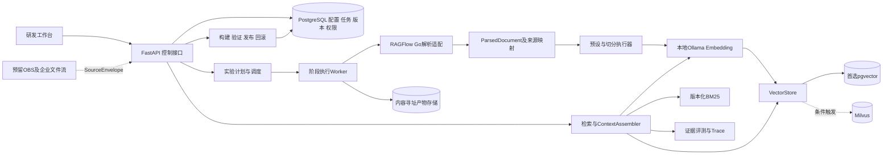

# RAG研发试验平台架构与代码实现方案

版本：v3，2026-10-22。本文结合已确定的v2范围与《开源产品与文档切分评测调研》修订；v1、v2已归档。目标是形成可实施、可追溯、可验收的研发平台设计。本次只更新设计文件，不表示下述组件已开发或通过测试。

## 1 定位和首期范围

平台面向企业文档处理研发人员，完成文件解析与切分试验、黄金集召回评测、版本发布回滚三个闭环。产品增强点集中在“企业来源可追溯、处理策略可配置、实验结果可比较、成果可验证发布”。

首期采用自建Vue前端、独立Python处理网关和Worker、冻结版本的RAGFlow Go解析桥接、本地Ollama以及可替换向量存储。优先复用现有PostgreSQL/pgvector，验证失败再部署Milvus。Java企业业务接入、真实OBS同步、企业SSO和完整企业文件流对接留到后续；AGE不自动带来GraphRAG需求。

首期可用路径为：上传文件 → 预设处理策略 → 解析和Chunk定位预览 → 多方案索引 → 固定黄金集评测 → 对照基线选择候选 → 完整知识库构建和发布 → 查询验证与回滚。发布对象既包含处理策略，也包含语料、模型、检索配置及验证证据。

### 1.1 本次关键优化

| v2设计 | v3落实方式 | 收益 |
| --- | --- | --- |
| 解析后直接进入切分任务 | 有明确输入输出的阶段流水线、不可变产物和检查点 | 改切分参数可复用解析；失败从有效阶段恢复 |
| 常见算法配置 | 预设与执行器分离、参数Schema、能力声明和版本固定 | 可视化配置真实对应不同策略，便于添加算法 |
| 多组参数扫描 | Experiment与Trial分离，限定搜索空间、资源预算和基线 | 参数比较可复现，不演变为无边界自动搜索 |
| 主要看Recall@K | 固定K与固定Token预算双轨，区间证据对齐 | 避免大块和高重叠靠返回更多文本虚高 |
| 发布时冻结索引 | 冻结ReleaseManifest与GatePolicy，完整构建再验证 | 实验结果可以成为可靠的发布依据 |
| 文件流只预留上传参数 | 统一来源事件、文件身份、修订及权限契约 | OBS拉取和企业推送后续共用摄入主链路 |

### 1.2 从开源项目借鉴到哪些模块

以下为设计借鉴，不表示采用全部上游代码或部署整个产品。

| 来源 | 借鉴核心 | 平台中的具体设计 | 复用边界 |
| --- | --- | --- | --- |
| [RAGFlow](https://github.com/infiniflow/ragflow) | 深度解析、结构化文档、来源定位 | ParserAdapter与ParsedDocument，隔离Go实现变化 | 复用冻结源码能力；平台只管理自有实验索引 |
| [Dify](https://github.com/langgenius/dify) | 声明式处理配置和可视化知识流水线 | PipelineSpec、配置表单与执行预览共用Schema | 借鉴交互与配置思想；首期不开发通用DAG，不直接复制其前端 |
| [AutoRAG legacy](https://github.com/Marker-Inc-Korea/AutoRAG/tree/main/legacy) | 多配置组合、评测和选优 | Experiment、Trial、SearchSpace与Pareto候选 | 原工具已进入legacy维护模式；借鉴实验模型，不依赖其完整运行栈 |
| [Haystack](https://docs.haystack.deepset.ai/docs/evaluation) | 类型明确的组件边界和组件级评测 | Parser/Chunker/Retriever接口、阶段契约测试 | 按需评估组件，不要求平台基于Haystack重新搭建 |
| [Onyx](https://github.com/onyx-dot-app/onyx) | 企业连接器、来源权限和索引新鲜度 | SourceDocumentKey、SourceRevision、Connector契约、权限检查 | 预留OBS/文件流；只实现本地上传路径 |
| [Chonkie](https://github.com/feyninc/chonkie)、[Docling](https://github.com/docling-project/docling) | 算法组件与统一文档结构 | ChunkerRegistry、Docling对照插件及表格/标题规则 | 先做来源契约与依赖验证；不是首期必装的双解析引擎 |
| [Chroma切分研究](https://www.trychroma.com/research/evaluating-chunking)、[HiChunk](https://github.com/TencentCloudADP/hichunk) | 证据效率和层次切分评估 | EvidenceAligner、MetricRegistry、层次块和预算评测 | 指标复现与平台自定义口径分别命名；HiCBench下载/许可待核验 |
| [Phoenix](https://github.com/Arize-ai/phoenix)、[RAGChecker](https://github.com/amazon-science/RAGChecker) | 调用链和逐题失败归因 | StageEvent、检索Trace与错误分类 | 首期自建轻量记录；不将LLM Judge加入必要依赖 |

代码、模型权重和数据许可分别核验。尤其Dify附加条件、Onyx ee目录、Phoenix ELv2及HiChunk第三方组件不可用项目名一概推断；具体核对结果见调研报告。

## 2 本地依据和待验证事项

下列为2026-10-22已完成的观察，来自local-validation.md；此后实施时重新检查服务状态。

| 项目 | 本次观察 | 结论 |
| --- | --- | --- |
| Ollama | CLI版本0.35.1；OLLAMA_HOST=127.0.0.1:11436 | 使用实际配置，不能默认11434；本机11434未找到目标Embedding模型 |
| Embedding | qwen3-embedding:0.6b；对两条中文文本调用/api/embed成功，均返回1024维向量 | 可作为首期稠密向量基线；本次调用约5秒包含加载因素，不是性能基准 |
| Embedding标识 | ac6da0dfba84a81fdbfbaf330198c33cd77c4cdfc53e8bc50eb581914a15621d | 实验记录完整digest，禁止仅依赖可变模型标签 |
| Reranker | dengcao/Qwen3-Reranker-0.6B:F16及Q8_0已安装；Q8_0能力显示completion | 已安装不等于已有可靠的重排分数接口；独立验证后启用 |
| PostgreSQL容器 | graphrag-postgres-age，已停止；映射127.0.0.1:5432 | 当前未连接数据库，也未改动既有数据 |
| 数据库构建配置 | 基于apache/age:release_PG17_1.7.0，编译pgvector v0.8.6；初始化SQL包含age及vector扩展 | 有复用依据；仍需查询实际运行版本及目标数据库pg_extension |
| 代码 | 已拉取upstream/ragflow，调研SHA为e2401e54947db7eb5e542b6de26755d89886f783 | 源码未修改，尚未构建；调研提交不等于生产定版 |

数据库构建配置来自现有容器的Compose工作目录D:/公司文件/26年实施项目/GraphRAG/config/postgres-age。配置文件不能证明既有数据卷已经执行了新初始化脚本。启动后以SELECT version()、pg_extension和pg_available_extensions结果为准；不打印连接密码，不重建原卷。

Apache AGE负责图数据；pgvector负责向量相似性。首期不实施GraphRAG，AGE保持现状。新增独立rag_lab数据库及最小权限角色，避免在原GraphRAG业务表中混写；扩展需在新数据库单独启用，不能假定实例安装即各数据库可用。


本期尚未完成RAGFlow构建/解析桥接、数据库实际扩展检查、真实向量写查删和Reranker分数验证。已有Embedding两条样本成功不等于容量或召回验证通过。各项状态进入能力矩阵，不以环境安装推导功能可用。

## 3 架构和责任归属



网关与Worker共用领域代码，独立进程运行，关系库保存持久任务。初期不新增Redis、Celery和消息中间件；RAGFlow自身的运行依赖另列，不能默认被平台PostgreSQL替换。所有平台检索写入由VectorStore执行，上游仅提供约定的解析能力，不把同一数据同时交给RAGFlow自动切分和平台切分。

平台拥有的事实：文档身份、解析快照引用、策略版本、实验、索引绑定、黄金集和发布指针。RAGFlow拥有其自身运行配置和解析实现；Ollama拥有推理服务；存储后端拥有物理索引。跨系统状态通过任务和对账协调，不以跨库原子事务假设设计。

### 3.1 RAGFlow定制路径

采用解析桥接优先：冻结可部署提交 → 验证ParseResultProducer.ParseWithResult → 映射结构化块/表格/位置 → 对外稳定内部协议。当前调查路径是internal/parser/parser、internal/ingestion/component及相关handler/router。所有上游代码修改遵循该仓库Go路径与build.sh构建要求；外部Python网关放在独立目录。

现有HTTP入口若不能完整导出结构和定位，则在Go侧新增范围有限的解析桥接。其对外返回ParsedDocument兼容结构或标准中间产物引用。是否需要独立Go解析服务与上游原生引擎，P0以实际依赖确认，不提前承诺轻量无依赖部署。

Docling作为后续ParserAdapter对照候选；如果RAGFlow桥接不通过，则先形成阻塞原因及替代成本报告。替换解析器需显式记录，不以其他解析器的结果宣称RAGFlow链路已打通。

### 3.2 存储和模型选择

pgvector以独立rag_lab数据库起步，平台业务表与向量表隔离管理。先做精确余弦检索，再对同一数据测HNSW；workspace、知识库、index_version和授权过滤必须在候选召回前应用。AGE只保留现有图能力。

P0建议在1万/10万块两级数据核验幂等、过滤、重启和延迟。拟定10万块/并发5纯检索P95≤500ms、ANN相对精确Recall@10≥0.95，为待确认门槛。判断失败前排除模型冷启动、OCR和无效查询计划等因素；不以更换数据库解决推理瓶颈。

无法可靠启用扩展、隔离/过滤行为不满足，或合理调参后仍达不到确认的容量目标，再启用Milvus备用profile，使用相同VectorStore契约和同一批语料重测。迁移采用候选索引构建、评测、发布存储绑定；不在线双写。Milvus不会替代平台台账，也不会自动移除RAGFlow原生引擎。

本地Embedding绑定qwen3-embedding:0.6b及完整digest，1024维，调用/api/embed时truncate=false。文档前处理、查询指令前缀、归一化和上下文配置共同版本化。Docker内验证宿主11436连通性，不误用容器自身回环地址。

Reranker单独注册能力，核验分数协议、方向、批量顺序及排序稳定性后启用；Ollama模型显示completion不代表已有可靠重排API。首期默认关闭未验证重排；三个闭环不依赖生成模型。模型更新或维度相同但digest变化均创建新索引绑定。

## 4 流水线和可复用产物

### 4.1 固定顺序的声明式流水线

首期只支持下列受控阶段与参数，不提供任意脚本、环路或任意图执行：

```text
接收源文件 → 校验/快照 → 解析 → 规范化和来源映射 → 切分
         → Embedding → 构建向量/BM25索引 → 验证
检索阶段：授权 → 固定Release → 查询向量/全文 → 融合/可选重排
         → 父块/邻接扩展 → 上下文装配 → 证据与指标
```

PipelineSpec包含schema_version、parser_binding、normalizer_binding、chunker_binding、embedding_binding、index_binding及retrieval_binding。处理顺序由平台版本固定。每个binding指向不可变版本，不引用会随时变化的“当前默认”。前端表单、后端校验、参数扫描共用同一JSON Schema；提交后保存规范化JSON及config_hash。

索引构建和检索配置分开：修改TopK/预算/RRF可复用索引；修改解析器/切分/Embedding需从相应阶段生成新产物。变更影响范围见下表。

| 变更 | 从哪里重新执行 | 可复用内容 |
| --- | --- | --- |
| 原文件hash/解析器或OCR配置变化 | 解析及其后所有阶段 | 原始文件快照 |
| 规范化/阅读顺序策略变化 | 规范化及后续 | 原始解析产物 |
| 切分规则/重叠/标题或表格策略变化 | 切分及后续 | 解析和规范化快照 |
| Embedding digest/前缀变化 | Embedding和向量索引 | 同版Chunk；全文索引仅在内容及分词不变时复用 |
| 索引类型/HNSW参数变化 | 物理索引构建 | 已有向量与内容 |
| TopK/RRF/重排/预算变化 | 检索与评测 | 兼容且已就绪的索引 |
| 黄金标签/指标版本变化 | 评测；必要时复用原始Trace重算 | 检索配置与实际返回完全相同时可复用Trace |

### 4.2 产物和缓存规则

每个阶段输入输出均保存ArtifactRef：workspace_id、artifact_id、kind、schema_version、content_hash、parent_refs、producer_version、config_hash、storage_ref。内容寻址只是复用手段，不将跨工作区文件存在性暴露给用户。授权必须在命中缓存前执行；首期缓存按workspace分区。

缓存键含阶段名、所有输入hash、配置hash、代码/插件版本和模型digest。Embedding缓存另含实际输入文本、用途角色和前处理；查询缓存另含授权范围及权限修订号。原文件内容相同不代表同一业务文件，身份映射仍独立。

可复用产物写临时位置，hash/Schema校验通过后登记成功检查点；部分写入不可复用。非确定性组件记录seed和运行参数，缓存策略必须声明；不承诺不同硬件上的浮点位级一致。

### 4.3 任务恢复与资源约束

Job管理用户级任务，StageRun记录阶段，Attempt记录重试。状态为QUEUED/RUNNING/SUCCEEDED/FAILED/CANCELLED；每阶段成功必须有已提交产物。Worker通过数据库事务领取任务及递增fencing_token，心跳续租；过期Worker不能提交状态或发布指针。Vector写入主键包含index_version_id与chunk_id，重试按确定ID幂等写入。

崩溃后先对账产物和外部写入再恢复，不能把“调用超时”当成“没有执行”。取消是合作式停止：不领取新阶段，等待正在运行阶段结束或超时，不发布候选索引。残留候选数据由引用检查后的清理任务回收。

首期模型任务并发默认1、全局活动Trial默认2、单实验参数组合上限20，作为可调安全起点；单试验可配置时间和Token/文本预算。超预算标记终止原因并保存已完成结果。CPU解析、Embedding和评测分别排队，不以无限并发消耗本地GPU。

## 5 文档中间表示与预设策略

### 5.1 ParsedDocument和来源映射

规范化文档包含document_revision、parser_binding、blocks、outline、warnings及normalization_map。Block至少包含block_id、type、text、order、section_path、page可空、bbox可空；表格块另带rows/cells/header及单位信息。DOCX等没有可靠物理页码时保留段落/章节定位，不推造页码。

稳定定位键为document_revision + normalized_text_revision + block_id + Unicode码点[start,end)。原始坐标、解析块坐标、规范化字符坐标之间保留映射。block_id只在对应解析快照内稳定，换解析器后必须重新对齐，不能声称天然跨解析稳定。

Chunk由一组source_spans和必要的render_segments组成，不强迫每块只有一个连续区间。每个segment标记原文引用、重复表头或synthetic文本，重复表头指向同一原文位置。编辑生成新的derived文本版本；精确映射无法保持时显示来源不完整，禁止用于需要精确区间的默认验收。

表格行与表头关联、标题路径、列表/条款编号在切分之前保留。内容hash用于缓存，chunk_id含索引/切分版本及ordinal，不能只按文本hash生成，否则同文不同位置会被错误合并。

### 5.2 策略注册表与预设

StrategyPreset是配置模板；用户实例化后生成可编辑草稿，保存为StrategyVersion时不可变。ChunkerRegistry登记执行器版本、参数Schema、输入块类型、语言/格式能力、是否依赖模型、输出定位支持、最大输入和许可引用。若不能输出可靠来源映射，不能用于精细证据评测。

| 首期预设 | 执行方式 | 结构约束和展示 |
| --- | --- | --- |
| 通用文本 | 递归段落/句子/字符切分 | 目标800码点、重叠100作为起点，保证有进度 |
| 滑动窗口 | 固定窗口按可配置边界微调 | 明示长度单位，记录微调后的实际长度 |
| 制度规范 | 标题层级与条款优先，超长再递归 | 保留section_path，不把孤立标题作为无内容块 |
| FAQ | 问答对识别和相邻组合 | 无法识别时提示并按显式规则退回递归 |
| 表格 | 行组+表头、单位和邻接标题 | 单行超限明确标记，不静默截列；重复表头映射到原文 |

首轮试验窗口可用400/800/1200、重叠0/100；非法组合在提交前拒绝。第二批加入父子分段、语义分段、OCR扫描件、代码/Markdown结构策略。父子策略同时定义child检索、parent扩展、合并和预算规则，属于完整检索方案，不能仅改Chunker名称。

Chonkie可作为执行器插件，但来源定位与长度语义由平台契约约束；库不满足契约则做受控适配或不启用。RAGFlow和Docling的输出经各自ParserAdapter归一，算法插件不直接依赖其内部对象。

## 6 实验模型与研发工作台

Experiment绑定一个研究目标、语料快照和基线；Trial绑定一组明确参数及执行环境。Experiment定义实验模式：CHUNK_ONLY、RETRIEVAL或END_TO_END。CHUNK_ONLY不调用向量模型；RETRIEVAL固定解析快照；END_TO_END允许解析器变化但不能把差异仅归因于切分。

SearchSpace只接受白名单参数的有限枚举，展开前计算组合数并校验资源预算。每个Trial保存解析/切分/检索配置、模型digest、语料和黄金集版本、Tokenizer版本、随机种子及产物引用。失败Trial保留并计入总数，不因失败隐藏结果或影响相邻方案完成。

首期按可解释的分阶段搜索执行：先三种基线与小参数网格 → 固定优选切分后比较检索模式 → 最后验证重排。避免切分、模型、数据库和Rerank同时变化造成无法归因。自动选择只推荐满足门槛的Pareto候选，不自动覆盖线上版本。

工作台包含源文件/结构面板、策略参数面板、Chunk对照区及任务进度。评测页在总览之外必须能打开逐题原文，分别高亮黄金证据、命中、遗漏和重复片段。用户可导出配置、manifest和指标报告，导出不含密钥和无权访问的原文件。

界面导航按研发过程组织：语料与来源 → 处理试验 → 策略库 → 基准与评测 → 实验比较 → 发布与诊断。首期采用步骤编辑和线性阶段视图，未来若需要DAG再基于已有阶段契约扩展。

## 7 基准、检索与指标

### 7.1 统一基准包和能力声明

基准包由manifest.json、corpus.jsonl、queries.jsonl、qrels.jsonl及可选evidence_spans/boundaries/layout标注组成。DatasetAdapter负责导入官方数据并输出统一结构，声明has_document_qrels、has_exact_spans、has_boundaries、has_layout、has_answers及language。

manifest固定source URL、revision、license、split、normalize版本、hash和数量。标签层级不支持的指标显示N/A，不能填0。导入报告统计有效/无效/无法对齐题数和原因；开发与验收按文档及近重复家族拆分，保留官方split。

首批按顺序核验LegalBench-RAG子集、QASPER验证集子集、企业中文黄金集；Chroma数据和指标作为研究对照。HiCBench先核验数据可获取性和许可，再加入层次边界测试；CRUD-RAG用于后续中文端到端补充，OmniDocBench/OHR-Bench归解析诊断。首期不全量灌入8万新闻或50万模拟企业文档。

QASPER支持段落证据，不将段落标签伪装为最小字符答案；LegalBench-RAG的代码MIT不能覆盖全部原文来源许可。已发现许可限制和获取问题详见独立调研报告。

### 7.2 EvidenceAligner

黄金证据锚定规范化原文中的文档修订、block和字符区间，精确对齐后才计算位置指标。跨解析器使用来源坐标/文本映射重新对齐，并输出aligned/ambiguous/unaligned，不用低置信度模糊匹配强行评分。

评测记录区分“执行失败”与“无可用标签”。有效标签题的检索超时或空命中效果计0，不能剔除；对齐失败题进入数据质量统计，并阻止要求精确证据的发布门槛通过。无答案题不进入Recall分母，另测拒答/阈值行为；不能把向量引擎返回非空候选直接视为幻觉回答。

### 7.3 检索Trace和上下文装配

检索按workspace/知识库授权 → 固定release及index/model绑定 → 向量/BM25召回 → RRF → 可选Rerank → 父块/邻接扩展 → ContextAssembler执行。服务端构造过滤，客户端不能直接提交物理表、集合名或SQL。两路候选与缓存均限制授权范围，返回前再次核验。

BM25使用冻结分词和全文索引；PostgreSQL ts_rank不命名为BM25。首期小语料可使用按index_version构建的本地BM25快照；语料/分词变化生成新快照。RRF默认sum(1/(60+rank))，名次从1开始；原始分数、融合和重排结果分别记录。

RetrievalTrace至少包含查询配置hash、release/index、候选及各阶段分数、expanded块、最终上下文、source_spans、装配结果、Tokenizer绑定、阶段耗时和错误。ContextAssembler固定先按来源去重/合并，保留排序；预算不足时按冻结规则在句/行边界截断或跳过，并记录实际截断来源。最终评分面向真正交付的上下文，不能只评命中子块而隐藏返回父块的成本。

### 7.4 两条公平比较轨道

固定K轨道用K=3/5/10，显示实际上下文Token数；固定预算轨道建议512/1024/2048 Token，比较同一预算内的证据覆盖与噪声。候选池、重排开关和装配规则在同一次对照中保持一致，所有配置进入快照。

TokenizerBinding包含实现、revision、是否计特殊Token和分段策略。Ollama接口不保证提供文本offset，因此精确Token位置指标只在可获得冻结Tokenizer及映射时启用。否则字符证据指标仍可用，Token预算轨道标记不可用，不能用“字数/若干”估算成精确Token预算。

精确证据主口径采用字符位置集合：G为黄金证据并集，U为实际上下文覆盖的唯一原文位置；字符成本C统计实际文本码点数，重复内容和synthetic文本计入成本。Token口径另用冻结原文Token位置及映射计算，不能将字符分子除以Token分母。边界重分词导致两种计数体系不一致时，报告独立字段，不制造可比精度值。

| 指标组 | 首期指标和口径 |
| --- | --- |
| 证据覆盖与噪声 | char_recall=count(G∩U)/count(G)；char_precision_unique=count(G∩U)/count(U)；char_iou_unique=count(G∩U)/count(G∪U) |
| 真实成本 | 有效证据字符成本比=count(G∩U)/C；独立报告delivered_tokens、重复来源字符数/实际字符数；Token级指标仅在具备同单位映射时启用 |
| 检索排序 | 文档Recall@K、Hit@K、MRR@K、nDCG@K；块到文档按最高块分数聚合，tie-break用文档版本ID |
| 结构与切分 | 空块率、长度分布、超限率、表格/条款破坏；有边界标签时Boundary F1和层次F1，Pk/WindowDiff放第二批 |
| 性能 | 解析/切分/向量化时间、检索与重排P50/P95、错误率、向量数、存储；冷热推理分别计时 |

Chroma-compatible指标另行注册并严格复现其重复计数，不把上述平台unique版本称为论文原式。指标带metric_id/version/unit/direction/required_labels，MetricRegistry保证跨实验计算版本一致。

宏平均按题、再按数据集分开展示；无关语言和不同标签粒度不拼成单一总分。可增加以文档为簇的配对bootstrap置信区间作为增强功能。首期优先保留逐题结果和样本数，避免样本变化后比较无意义。

## 8 发布、验证与回滚

StrategyVersion可单独保存/导出模板；Release则是可查询的完整知识库版本，两者在页面及API上区分。策略实验只含部分文件时，发布会创建完整manifest构建任务，不能直接把样本索引替换目标知识库。

ReleaseManifest固定corpus_manifest_hash、pipeline_spec_hash、所有组件版本、embedding/tokenizer绑定、物理向量与BM25索引、检索/装配配置、黄金集版本、metric版本、GatePolicy与报告hash。构建中新增文件进入下一manifest，避免变化输入污染候选版本。

状态为DRAFT → BUILDING → VALIDATING → READY → ACTIVE；失败保留FAILED及原因。ACTIVE由发布指针决定，旧版发布记录不被改写。发布事务用expected_release_id及row_version进行CAS，失败返回409，任务恢复也不能跳过该比较。

### 8.1 验证门槛

GatePolicy作为不可变配置，包含适用基准/切分、必需指标、绝对阈值、相对基线允许退化、错误率和数据完整性要求。无可用精确标签时，门槛结果为INCONCLUSIVE，不自动PASS；baseline缺失时进入初次验收策略，不把缺少结果当成0。

首轮必须满足：完整文档manifest、维度及模型匹配、权限回归零泄漏、指定评测无执行错误、精确证据标签全部可对齐、报告和索引绑定一致。业务Recall阈值先按验证集确定并固定，原v2的文档0.90/证据0.85仅保留为待校准候选值，不作为所有公开集统一承诺。

验收集与调参集分开，UI不反复以验收集自动搜索参数。Gate报告固定基线版本、可比条件、每项结果及拒绝原因。开发环境允许显式使用sandbox发布策略，但必须有独立命名和状态，不能绕过正常发布验证后仍标为已验收。

### 8.2 查询和恢复一致性

PostgreSQL active_release_id为唯一业务读路由。一次查询固定发布版本、Embedding、向量与全文索引以及装配参数；全局模型默认变化不影响旧Release。pgvector按index_version隔离，Milvus按不可变物理集合隔离；别名仅作为可选兼容映射。

回滚需验证旧manifest、向量/BM25数据及原模型仍可用；权重已被删除则回滚受阻，不能用同名新模型替代。历史实验区分结果可查看与可运行重放，两者不能混称。权限采用当前有效授权，回滚不得恢复已撤销的访问权。

保留最近2版且至少7天作为本地起点；GC在保留窗口外检查活动Release、实验、任务和缓存引用后清理。备份同时包含台账、发布manifest、原文件、解析/切分产物、向量及全文数据、配置及模型获取引用。恢复后先验证绑定与权限，再对外查询。

## 9 企业文件流的预留设计

采用Onyx式来源身份与元数据传播思想，统一SourceEnvelope：workspace_id、source_id、external_document_id、source_revision、operation、file_name、mime_type、expected_sha256、source_uri、event_time、metadata、acl_ref及acl_revision。首期acl_ref仅为可空预留字段，实际权限由本地工作区成员控制；后续启用来源权限时缺失或无法解析ACL应隔离待审，不能默认全员可见。

业务身份为(workspace_id,source_id,external_document_id)；内容修订独立。相同身份/修订/hash幂等复用受理结果，同修订不同hash返回409。不同来源同名文件不合并；内容去重只影响存储缓存，不影响文档身份。

未来OBS拉取实现scan(cursor)与open_stream(ref)，企业推送使用HTTP文件流；二者转换为同一Envelope并进入校验、快照和处理任务。源修订号作为不透明标识，不默认可按字符串排序；每种连接器声明版本顺序策略。旧事件重放不自动覆盖新版。删除事件默认仅记来源tombstone，已发布数据是否下线由显式生命周期策略决定。

首期实现人工上传的流式入口及SourceEnvelope Schema/契约测试；OBS扫描、续跑、ZIP、企业服务账号、ACL同步、回调签名和生产限流分别放后续里程碑。保留GET /ingestions/{id}查询，接收成功返回202，只表示文件校验通过并入队，不表示索引或发布完成。

## 10 领域模型和代码接口

### 10.1 主要实体与约束

| 实体 | 关键字段与约束 |
| --- | --- |
| workspace/member | 服务端确定访问范围；角色admin/developer/viewer |
| source_document/document_revision | 业务身份唯一键、source revision、hash、原文件引用；修订不可变 |
| parse_snapshot/normalized_document | parser与normalizer版本、结构JSON、文本版本及offset map |
| strategy_preset/strategy_version | plugin binding、参数Schema、规范化配置hash；预设更新不修改已保存版本 |
| artifact/stage_run/job_attempt | 输入输出引用、producer版本、状态、lease、fencing；成功检查点必须有完整产物 |
| corpus_manifest/index_version | 完整文档修订清单、backend、向量维度、模型及全文绑定 |
| experiment/trial | 研究模式、基线、参数空间、单方案快照和任务引用 |
| benchmark_version/alignment_report | 语料、问题、标签能力、split、许可、对齐结果 |
| evaluation_run/item/retrieval_trace | 指标版本、上下文实际来源、逐题结果和错误，不只存汇总分 |
| release/gate_policy/gate_report | 冻结manifest、基线、门槛和证据；CAS发布 |
| model_binding/tokenizer_binding | 不可变digest/revision、前处理、维度及密钥引用；endpoint另受控配置 |

各唯一键包含workspace，不依赖前端传来的租户范围。JSON配置以schema_version校验，并保留升级转换器；升级配置产生新版本，不原地改历史快照。跨后端只暴露IndexBinding，不让页面操作任意物理集合。

### 10.2 组件契约

| 接口与签名 | 输入输出决定的行为 |
| --- | --- |
| ParserAdapter.parse(source: ArtifactRef, binding: ParserBinding) -> ParsedDocumentRef | 结构块、警告和定位能力均显式输出 |
| Normalizer.normalize(parsed: ParsedDocumentRef, binding: NormalizerBinding) -> NormalizedDocumentRef | 输出规范化文本及来源映射 |
| Chunker.split(document: NormalizedDocumentRef, binding: ChunkerBinding) -> ChunkSetRef | 不修改输入；输出parent关系、多span和render segments |
| EmbeddingProvider.embed(texts: list[str], binding: ModelBinding, role: str) -> EmbeddingBatch | 顺序与输入一一对应；维度/有限数校验，禁止静默截断 |
| VectorStore.build(binding: IndexBinding, rows: VectorBatchRef) -> IndexStatus | 只写指定候选版本，确定ID幂等；ready前不发布 |
| VectorStore.search(binding: IndexBinding, query: list[float], scope: AccessScope, limit: int) -> list[Candidate] | 授权过滤先于召回；返回source引用和原始分数 |
| DatasetAdapter.import_bundle(source: DatasetSource) -> BenchmarkVersionRef | 标签能力和导入/对齐错误可查询 |
| EvidenceAligner.align(benchmark: BenchmarkVersionRef, corpus: CorpusManifestRef) -> AlignmentReportRef | 不用低置信度匹配伪造有效证据 |
| ContextAssembler.assemble(candidates: list[Candidate], binding: AssemblyBinding) -> AssembledContext | 实际文本、来源span、截断/重复及Token计数明确 |
| Evaluator.run(plan: EvaluationPlanRef) -> EvaluationReportRef | 固定基准、指标和实际上下文，结果逐题保存 |
| ReleaseService.publish(candidate_id: str, expected_release_id: str或空) -> PublishResult | 构建、Gate验证与CAS切换有独立状态 |

这些名称为拟建平台接口，不是声称上游已有相同函数。Ref类型为同一workspace内不可变产物ID与hash引用；Binding类型为schema校验过的不可变配置；Candidate包含chunk/doc/index ID、分数及source引用；批量写入与读取使用分页，不要求完整语料一次装入内存。

### 10.3 拟建代码结构

```text
upstream/ragflow/               独立上游仓库，Go侧范围有限的解析定制
frontend/src/
  pages/                       语料、工作台、基准、对比、发布、诊断
  components/                  StageTimeline、ChunkDiff、EvidenceViewer
  schemas/                     由契约生成的表单Schema
rag-gateway/
  app/api/                     ingestion、experiments、benchmarks、release等
  app/domain/                  bindings、documents、artifacts、experiments、releases
  app/pipeline/                spec、registry、runner、invalidation
  app/worker/                  queue、lease、reconcile、gc
  app/strategies/               presets、registry、参数Schema
  app/adapters/parsers/         ragflow；docling后续按需增加
  app/adapters/models/          ollama、reranker
  app/adapters/vector/          base、pgvector；Milvus条件触发
  app/adapters/blob/            base、local
  app/connectors/               base和预留Schema；OBS后续
  app/retrieval/                vector、lexical、rrf、assembly、trace
  app/benchmarks/               registry、legalbench、qasper、user_bundle
  app/evaluation/               alignment、metrics、runner、comparison
  app/releases/                 build、gates、publish、rollback
  migrations/
  tests/unit/ tests/contract/ tests/integration/
contracts/                      OpenAPI及各版本JSON Schema
config/presets/                 五种首期预设及版本
benchmarks/manifests/            仅版本与来源登记，不默认分发原数据
storage/                        本地产物、候选索引；部署时独立持久目录
scripts/                        POC、契约验证、备份恢复
```

首期保留Vue 3 + TypeScript、FastAPI/Pydantic、SQLAlchemy/Alembic、PostgreSQL/pgvector。采用目录内聚而非微服务拆分；只有RAGFlow和Ollama属于外部执行服务。参数Schema、OpenAPI、预设配置和依赖补丁版本随代码锁定。

主要API包括：POST /ingestions、/experiments、/benchmarks/imports、/evaluations、/release-builds；GET /jobs/{id}、/trials/{id}/chunks、/evaluations/{id}/items/{query_id}/trace；POST /releases/{id}/activate和/rollback。前缀/api/v1，写接口使用Idempotency-Key；409表示冲突，422参数错误，503依赖不可用。模型端点密钥不回显，插件仅允许运维部署的实现。

## 11 分阶段实施计划

每个任务产出可以独立运行的纵向闭环，先用行为断言确认缺失能力，再实现和验证。以下均为计划，当前未完成实现；测试命令在对应目录和依赖可用后运行。

| 任务 | 主要文件/接口 | 必须通过的行为与验证 |
| --- | --- | --- |
| T0 上游和环境POC | adapters/parsers/ragflow、deploy版本锁、capability-matrix | 真PDF/DOCX/TXT解析含可追溯结构；Go桥接依赖可构建；本地模型批量顺序/维度正确；pgvector真实读写删和隔离通过；上游测试走build.sh要求 |
| T1 统一文档与产物 | domain/documents、artifacts、ingestion、blob | 断流不入库；重复文件不重复创建修订；不同来源同名不同身份；规范化offset可追溯；未授权缓存命中仍拒绝；test_ingestion/test_artifacts |
| T2 阶段流水线与恢复 | pipeline/*、worker/* | 修改Chunk配置仅使后续失效；损坏检查点不可复用；Worker租约过期不能提交；重复外部写入可对账；test_pipeline/test_job_recovery |
| T3 策略试验闭环 | strategies/*、workbench和ChunkDiff | 五种真实预设；窗口有进度；20组上限；表头重复来源正确；编辑后映射失效可见；test_chunkers/test_provenance及前端交互 |
| T4 基准与确定性指标 | benchmarks/*、evaluation/alignment和metrics | 手工含重叠/跨文档例子精确计分；无标签为N/A；对齐失败不伪造命中；QASPER段落和精确span能力区分；test_dataset_contract/test_metrics |
| T5 检索和公平比较闭环 | retrieval/*、evaluation/runner | 向量/BM25过滤一致；固定K与固定预算双轨；父块按实际输出计成本；未安装Tokenizer时预算不可用；超时题计0并保留错误；test_retrieval/test_assembly |
| T6 发布回滚闭环 | releases/* | 样本实验触发完整构建；缺少标签Gate为INCONCLUSIVE；并发仅一CAS成功；回滚仍用旧模型和新权限；test_release_consistency/test_gates |
| T7 前端联调与文件流预留 | 全流程页面、connectors/base、contracts | 上传→试验→对照→逐题证据→完整构建→发布→查询→回滚；SourceEnvelope契约可扩展；不出现已上线OBS的误导状态 |
| T8 诊断、恢复与基线报告 | Trace页面、scripts、runbook | 冷热耗时、存储和错误可定位；备份恢复后manifest/模型/索引一致；旧数据未被破坏；形成真实容量和回归报告 |

任务依赖：T0 → T1/T2 → T3 → T4/T5 → T6 → T7/T8。前端可以依据固定契约推进，但Mock结果不作为全链路验收证据。T4先用小黄金集跑通，再逐步导入公开基准；第一次发布不等待所有可选算法、OCR或LLM Judge。

Python验证在rag-gateway下运行python -m pytest tests/unit tests/contract；真实服务单独运行tests/integration；前端在frontend运行pnpm test及pnpm exec playwright test；RAGFlow按冻结提交AGENTS.md经build.sh运行相应层级。不存在测试文件或全部被跳过不算通过。

首期重点人工复核五类条件：同文本不同来源；手工编辑及表格表头映射；父块扩展超预算；构建期间文档变化；旧Release模型被移除后的回滚。对应测试分别归T1、T3/T4、T5、T6、T6/T8。

## 12 工作量和交付边界

复杂度仍为中高。v3把评测可信性和阶段恢复纳入首期，避免后期因无法复现或对齐而返工；这会增加部分前置投入，不能沿用v2总量不变的假设。

| 工作包 | 估算人日 |
| --- | --- |
| RAGFlow冻结与解析桥接POC | 6–10 |
| Ollama与pgvector契约和能力探测 | 4–7 |
| 统一文档、产物、阶段任务与权限 | 10–15 |
| 预设、参数实验、来源对齐 | 8–12 |
| 基准适配、指标、装配与公平检索 | 12–18 |
| Gate、完整构建、发布与回滚 | 7–11 |
| 前端工作台、比较及证据查看 | 12–17 |
| 文件流契约、集成、诊断及恢复 | 7–10 |
| 合计 | 66–100 |

加入20%–30%储备约79–130人日；3名有效投入且熟悉相关技术的开发人员，建议8–11周形成首期，3–4周争取完成最小文件试验闭环。以上为工程估算，非承诺排期，需P0校准并考虑关键路径与人工标注。

相较v2增加10–13基础人日，主要来自阶段恢复、统一基准适配、预算装配和发布Gate。公开基准下载/许可核验不等于用户自己的中文黄金标注工作量；业务专家标注需单独安排。

如果需Milvus备用实现，额外约3–6人日；如果RAGFlow最小桥接失败而改成完整文档引擎适配，另加12–25人日并重新估算。完整OBS/企业连接器、SSO、通用DAG、模型训练、GraphRAG和生成答案评审不包含在首期估算内。

## 13 验收与下一阶段

首期验收以三个闭环真实运行、同配置可追溯重放、实验公平且发布可恢复为主。必须提供：冻结版本清单、ParsedDocument能力矩阵、真实模型/向量库契约结果、固定小基准逐题报告、完整manifest与Gate记录、全流程界面验证和恢复记录。

建议以30–50份授权企业文档、100–200个核对过证据的问题开始，包含文本、条款、表格、多证据、无答案和版本冲突，按文档分开发/验收。样本量是起点，不代表统计充分性；公开英文集不能替代中文企业验收。

下一阶段先完成T0及最小数据契约，使用已安装Ollama与隔离pgvector验证文件→解析块→切分→向量检索；再按T1–T8推进。当前源码已拉取、Embedding轻量调用已成功，其他能力尚待实现和验证。

## 14 参考材料和修订依据

- 项目原需求：《知识库技术方案（基于RAGFlow+Milvus）.docx》。最新用户范围优先于原文Java业务层要求。
- 本地证据：[local-validation.md](local-validation.md)。
- 产品/数据集/指标详细来源：[开源产品与文档切分评测调研](开源产品与文档切分评测调研.md)。
- [pgvector官方](https://github.com/pgvector/pgvector)、[Ollama Embedding接口](https://docs.ollama.com/api/embed)：技术能力在本地冻结版本上验证。
- [LegalBench-RAG](https://github.com/zeroentropy-ai/legalbenchrag)、[QASPER](https://huggingface.co/datasets/allenai/qasper)：首批数据适配候选，原始数据使用范围按各版本许可核验。

此设计保留v2已确认的技术方向，优化来源、实验和发布契约；所有第三方功能描述以先前调研及本地代码核对为依据，不新增“已集成”或“已跑分”的声明。
